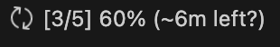
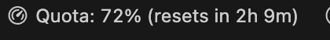
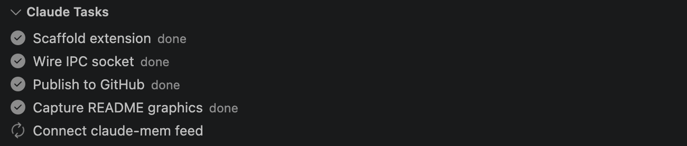
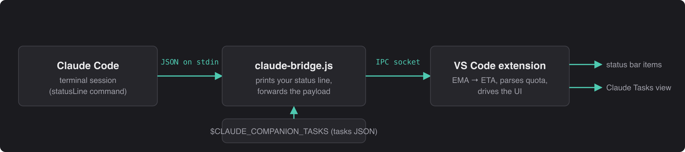

# Claude Code Companion

A VS Code extension that surfaces a local [Claude Code](https://claude.com/claude-code)
session in the editor: task progress with a live ETA, your 5-hour rate-limit quota,
and a task list in the Explorer.


> Real screenshots of the extension running in VS Code. The `?` after the ETA is
> the extension telling you it does not have enough samples yet to be confident.

## What you get

### 1. Task progress bar (bottom-left status bar)



- `[4/5] 80%` — completed / total and percentage, with a spinner while work is running
- `(~3s left)` — the estimate (see [How the ETA works](#how-the-eta-works) below)
- A trailing `?` — `(~2m left?)` — means too few or too erratic samples to lean on
- Redraws every 60s, so the countdown is live rather than frozen at the last update
- `(over by 3m)` on the final task means it has outrun the expected duration
- Turns into `✓ [5/5] 100%` when everything completes
- **Hover** shows the full task list plus what the ETA is based on
- **Click** opens the Explorer

### 2. Quota bar (next to it)



- Your claude.ai **5-hour rate-limit window**: percent used and time until reset
- Background turns **orange at 75%**, **red at 90%** — glanceable before you hit the wall
- **Hover** shows the 7-day window too
- Works with zero setup beyond the bridge; data comes straight from Claude Code

### 3. "Claude Tasks" in the Explorer sidebar



- Every task with a live status icon: ✓ completed, spinner for in-progress, ○ pending
- Updates in real time as payloads arrive — no refresh button, no polling

## How the ETA works

> **The ETA is a guess, not a schedule.** It projects the pace of your recently
> completed tasks onto the ones left. It cannot know that the next task is a
> one-line edit or a twenty-minute build, so treat it as a rough horizon — the
> `~` and the rounded figure are there to say so.

**It gets more accurate the longer a session runs.** With one completed task
there is a single measurement and the estimate is labelled a rough guess; as
tasks accumulate the estimate settles and the label upgrades:

| Shown | Meaning |
|---|---|
| no ETA | Nothing measured yet — needs one completed task |
| `(~2m left?)` | **Rough** — fewer than 3 samples, or a very uneven pace |
| `(~2m left)` | **Fair** — 3+ consistent samples |
| `(~2m left)` + "steady pace" in the tooltip | **Good** — a full window of consistent samples |

Hover the item to see the grade and how many completed tasks back it.

**It is live, not a snapshot.** Both time-based values redraw every 60 seconds
even when no new payload arrives, so they count down in real time instead of
freezing at whatever the last update said.

That matters most when a task stalls. If your pace has been ~5s per task and the
current one has been running eight minutes, the old behaviour kept promising
"~35s left" indefinitely. Now the elapsed time counts against the estimate, and
once a task outruns its expected duration the estimate **widens** — because
overrunning is evidence the measured pace no longer describes this session:

| Time since last completion | Shown |
|---|---|
| at the payload | `(~35s left?)` |
| +1 min, still running | `(~6m left?)` |
| +5 min, still running | `(~30m left?)` |
| task finally completes | `(~30s left?)` — re-settles |

The median window means one stall does not poison the following estimates.

Two more details that make it behave:

- **The time before your first completed task is discarded.** That stretch is
  startup, thinking and tool calls — counting it as "one task's duration"
  inflated the first ETA several-fold, which is the number you see most.
- **It uses a median of the last 5 durations, not an average.** One stalled task
  (a long build, a big file read) would drag an average for the rest of the
  session; a median shrugs it off and the item flags the spread as `rough`.

Measured against simulated sessions with a 30s startup, mean error over the
session and error at the end:

| Session shape | Mean error | Final error |
|---|---|---|
| Steady pace | 0% | 0% |
| One long stall mid-run | 25% | 0% |
| Very noisy durations | 30% | 29% |
| Pace changing throughout | 63–125% | 40–50% |

A pace that changes monotonically throughout is the worst case for any
pace-based estimate — it is extrapolating from a trend that keeps moving, which
is exactly when the `?` and the tooltip tell you not to trust the number.

## How it works



Claude Code runs your configured `statusLine` command on every session event and
pipes it session JSON on stdin. The bridge prints a terminal status line (so your
terminal still gets one) and forwards the payload over a local IPC socket — a Unix
domain socket at `$TMPDIR/claude-vscode-progress.sock`, a named pipe on Windows.
The extension listens, computes the ETA, and drives all three UI pieces. Nothing is
polled and nothing is written to disk.

## Install

```sh
git clone https://github.com/erDevKumar/claude-code-companion
cd claude-code-companion
npm install && npm run compile
ln -s "$PWD" ~/.vscode/extensions/claude-code-companion
```

Reload the VS Code window (`Cmd+Shift+P` → **Developer: Reload Window**). The
extension activates on startup; **Output → Claude Companion** should log
`Listening on …/claude-vscode-progress.sock`.

## Configure Claude Code

Add to `~/.claude/settings.json`:

```json
"statusLine": {
  "type": "command",
  "command": "node /abs/path/to/claude-code-companion/scripts/claude-bridge.js",
  "refreshInterval": 10
}
```

`refreshInterval` matters: without it the status line only re-runs on session
events, so the "resets in" countdown and ETA go stale between them.

## Use it

**1. Start a Claude Code session in a terminal.** After the first API response the
quota bar appears. That is the entire setup for quota tracking.

The bars are driven by the `statusLine` command, which Claude Code only runs for
**terminal** sessions. A session running inside the VS Code extension does not
invoke it, so nothing will appear from that alone.

**2. Feed tasks (optional).** Claude Code's `statusLine` payload carries no task
data, so tasks come from a JSON file you point `CLAUDE_COMPANION_TASKS` at:

```json
{"tasks": [
  {"content": "Wire IPC socket",  "status": "completed"},
  {"content": "Verify on device", "status": "in_progress"},
  {"content": "Ship",             "status": "pending"}
]}
```

Export it where Claude Code runs, e.g. in `~/.zshrc`:

```sh
export CLAUDE_COMPANION_TASKS=~/.claude/companion-tasks.json
```

The bridge re-reads the file on every refresh and ignores it when missing or
malformed. Anything that writes this file — a hook, a script, your own agent —
drives the progress bar and the tree. Statuses are `pending`, `in_progress`,
`completed`.

**3. Read the bar.** The ETA appears after the *second* completed task — the first
one only starts the clock, since the time before it is startup rather than task
work. It advances only when the completed count rises, so idle refreshes cannot
decay it toward zero. With an empty or absent list, the task bar and tree hide
rather than showing zeros. See [How the ETA works](#how-the-eta-works) for what
the `?` means and how far to trust the number.

### Push a test payload by hand

No Claude session needed — talk to the socket directly:

```sh
node -e '
const net = require("net"), os = require("os");
const payload = {
  model: { display_name: "Opus" },
  rate_limits: { five_hour: { used_percentage: 42, resets_at: Math.floor(Date.now()/1000) + 7200 } },
  tasks: [
    { content: "Wire IPC socket",  status: "completed" },
    { content: "Verify on device", status: "in_progress" },
    { content: "Ship",             status: "pending" },
  ],
};
net.connect(os.tmpdir() + "/claude-vscode-progress.sock")
   .end(JSON.stringify(payload) + "\n");
'
```

The payload must arrive as **one line** — the socket is newline-delimited, so a
pretty-printed JSON blob is read as several broken frames.

## Troubleshooting

- **Nothing in the status bar** — the bars hide when they have no data. Check
  **Output → Claude Companion** for the `Listening on …` line, then confirm the
  path in your `statusLine` command. Zen Mode also hides the status bar entirely.
- **Quota never appears** — `rate_limits` is only sent to claude.ai Pro/Max
  subscribers (or behind a gateway with spend limits), and only after the first
  API response of a session.
- **Two VS Code windows** — one window owns the socket; the other logs
  `Socket already served by another window` and stays idle rather than stealing it.
- **No ETA yet** — it needs two completed tasks: the first starts the clock, the
  second provides the first real measurement. No ETA early on is correct.
- **ETA looks wrong** — check the trailing `?` and the tooltip. A changing pace or
  a stalled task is reported as `rough` rather than hidden, because a stale
  number with no warning is worse than an honest rough one.
- **ETA keeps growing** — that is a task running well past your recent average.
  The estimate widens on purpose instead of repeating a figure the session has
  already disproved; it re-settles once the task completes.
- **Nothing moves for over a minute** — the bar redraws on a 60s timer, so a
  countdown that never changes across several minutes means the extension host
  is not running. Check **Output → Claude Companion**.

## Develop

```sh
npm run watch
node src/etaEstimator.test.js   # self-check, compile first
```

## License

MIT
